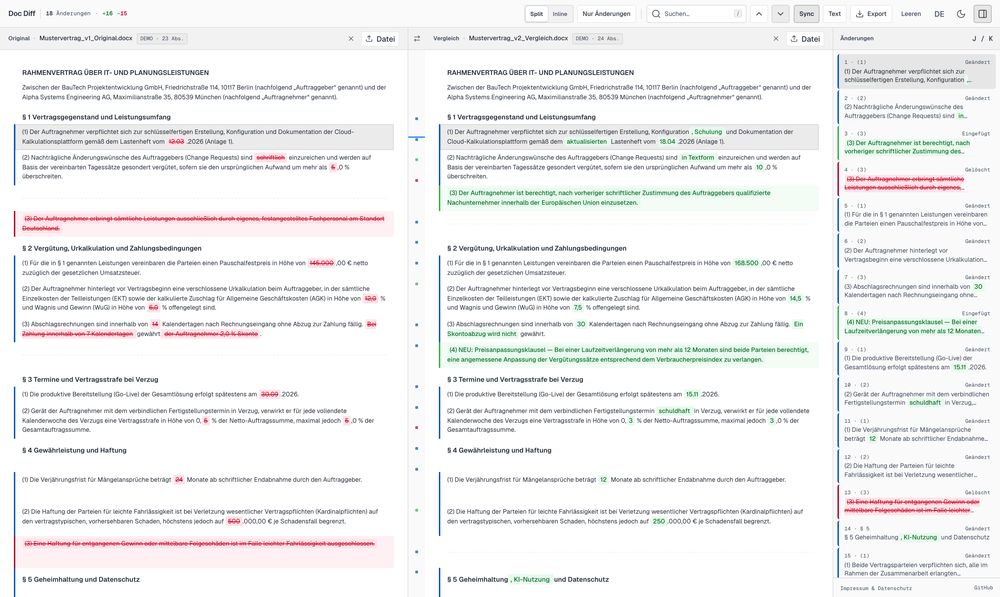

<h1 align="center">Doc Diff</h1>

<p align="center">
  <b>100% client-side, side-by-side document comparison for PDF, Word (.docx), and text.</b><br>
  Compare contracts, tenders, and redlines right in your browser.<br>
  Zero server uploads, zero external CDNs, enforced by <code>Content-Security-Policy: connect-src 'none'</code>.<br>
  Ships as a single self-contained HTML file that also works offline via <code>file://</code>.
</p>

<p align="center">
  <a href="https://docdiff.app"><b>docdiff.app</b></a> ·
  <a href="https://github.com/tschnorpfeil/docdiff/raw/main/DocDiff.html"><b>Download Standalone HTML (2.3 MB)</b></a> ·
  free and open source (MIT)
</p>

<p align="center">
  <picture>
    <source media="(prefers-color-scheme: dark)" srcset="docs/screenshot-dark.png">
    <source media="(prefers-color-scheme: light)" srcset="docs/screenshot-light.png">
    
  </picture>
</p>

---

## Why Doc Diff?

Comparing confidential contracts, schedules of rates (`Urkalkulation`), or legal redlines in cloud diff tools is often impossible under GDPR (DSGVO), NDAs, or professional secrecy rules. Meanwhile, existing open-source tools on GitHub usually cover only a fraction of the workflow:

| Capability | **Doc Diff** | `jamesmontemagno/pdf-diff` | `a-subhaneel/pdf-diff-viewer` | `xsukax/Word-Comparison` | Cloud SaaS Diff Tools |
| :--- | :---: | :---: | :---: | :---: | :---: |
| **PDF comparison (`.pdf`)** | **Yes** | Yes | Yes | No | Yes |
| **Word comparison (`.docx`)** | **Yes** | No | No | Yes | Yes |
| **Cross-format (`PDF` ↔ `DOCX`)** | **Yes** | No | No | No | Partial |
| **100% in-browser (`0 B` upload)** | **Yes** | Yes | Yes | No (Python server) | No (Cloud upload) |
| **Browser-enforced CSP lock (`connect-src 'none'`)** | **Yes** | No | No | No | No |
| **Single-file offline HTML (`file://` ready)** | **Yes (1 file)** | No (Vite build) | No | No | No |
| **Clause alignment (`§ 1`, `(1)`, `1.1`) + word diff** | **Yes** | No | Partial | Partial | Yes |

---

## Privacy & Security by Architecture (GDPR / DSGVO Safe)

Doc Diff is built so that any data protection officer or security auditor can verify in seconds that data exfiltration is technically impossible:

1. **Browser-Enforced Network Lock (`connect-src 'none'`):**
   The document embeds a strict Content Security Policy directly in `<head>`:
   ```html
   <meta http-equiv="Content-Security-Policy" content="default-src 'none'; script-src 'unsafe-inline'; style-src 'unsafe-inline'; font-src data:; img-src data: blob:; connect-src 'none'; media-src 'none'; object-src 'none'; child-src 'none'; worker-src blob:; frame-src 'none'; form-action 'none'; base-uri 'none';" />
   ```
   The browser engine itself blocks any outbound network request (`fetch`, `XMLHttpRequest`, `WebSocket`, `navigator.sendBeacon`, form submissions, or external image/script loads).
2. **Zero External Dependencies or CDNs:**
   All parsers (`PDF.js`, `Mammoth.js`, `jsdiff`) and typography (`Geist` & `Geist Mono` as Base64 `woff2`) are embedded inside the single HTML file. Opening the hosted GitHub Pages URL downloads one static HTML file—after that, **zero network requests occur**.
3. **Volatile RAM Only (Zero Persistence):**
   Document contents are never stored in `localStorage`, `sessionStorage`, `IndexedDB`, or cookies. Clicking **Clear** (`Leeren`) or closing the browser tab immediately discards all document data from memory.

---

## Key Features

- **Cross-Format Comparison:** Compare `PDF ↔ PDF`, `DOCX ↔ DOCX`, `PDF ↔ DOCX`, or pasted raw text side by side or in a unified inline view.
- **Responsive Across Desktop, Laptop, Tablet & Mobile:** Switch seamlessly between **Split (Side-by-Side)** and **Inline (Unified Redline)** view modes. Automatically adapts on tablets (slide-over change drawer) and smartphones (single-column inline redline with `100dvh` viewport sizing).
- **Clause-Aware Alignment:** Pre-tokenized Needleman-Wunsch dynamic programming with $O(N)$ prefix/suffix trimming aligns moved, inserted, or deleted contract clauses (`§`, `(1)`, `1.1`, `Section`) and coalesces adjacent word, number, and date changes into clean red/green inline highlights.
- **Synchronized Scrolling & Bi-Directional Hover:** Hovering any clause highlights its counterpart across both panes, draws a smooth Bezier connector across the center gutter, and highlights the corresponding entry in the change list.
- **Direct Inline Clause Editing & 1-Click Revert (`↺ Original`):** Double-click any clause in the revised or unified pane to edit its text directly in place (`Enter` to apply, `Esc` to cancel) and re-run the diff in `< 5 ms`. Hover any changed clause to click **`↺ Original`** and revert that specific clause back to the original version (`Cmd+Z` / `Ctrl+Z` to undo).
- **Multi-Format Client-Side Export:** Export comparisons locally without any server roundtrip:
  - **Copy Final Text:** 1-click copy of the clean, edited target text to the clipboard
  - **PDF / Print (`Cmd+P` / `Ctrl+P`):** Clean two-column or unified redline print layout
  - **Word Redline (`.doc`):** Formatted Word-compatible redline document with `<del>` strikethroughs and `<ins>` insertions
  - **HTML Report (`.html`):** Standalone, read-only HTML diff report for archiving or sharing
  - **Markdown (`.md`):** Clean Markdown diff summary (`~~deleted~~` / `**inserted**`)
- **Keyboard-First Navigation:**
  - `J` / `K` — Jump to next / previous change
  - `/` — Focus full-text search
  - `C` — Toggle "Changes only" (`Nur Änderungen`) filter
  - `Cmd+Z` / `Ctrl+Z` — Undo inline clause edits or reverts
  - `Esc` — Close menus, drawers, or dialogs
- **Bilingual UI (`DE` / `EN`):** Auto-detects browser language with an instant `DE` / `EN` toggle in the header bar and built-in sample contracts in both German and English.

---

## Usage

### 1. Hosted Web App (`docdiff.app`)
Open **[docdiff.app](https://docdiff.app)** in any modern browser and drop two files onto the left and right panes (or drop two files at once).

### 2. Local Standalone File (`file://` / Air-Gapped / Offline)
Download **[`DocDiff.html`](https://github.com/tschnorpfeil/docdiff/raw/main/DocDiff.html)** to your computer, intranet share, or USB drive and double-click it to open in Chrome, Safari, Firefox, or Edge. No internet connection or local web server required.

---

## Building from Source

Edit [`src/template.html`](src/template.html) and run the build and verification scripts:

```sh
python3 scripts/build.py
node scripts/check.mjs
```

- `scripts/build.py` bundles `src/template.html` with the pinned libraries and fonts in `vendor/` to produce `site/index.html` and `DocDiff.html`.
- `scripts/check.mjs` verifies CSP headers, zero external URLs, zero storage APIs, and 1:1 `de`/`en` translation key parity.

---

## License

MIT License — see [LICENSE](LICENSE) and [THIRD_PARTY_NOTICES.md](THIRD_PARTY_NOTICES.md).
